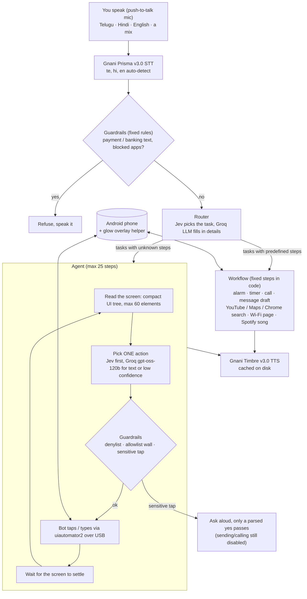

# Sugam

**Easy phone access, in your own language.**

Your grandmother shouldn't need English or steady hands to set an alarm. With Sugam, she just says it.

Sugam is a laptop-tethered agent that controls a real Android phone by voice, in Telugu, Hindi, English or a mix. You speak; **Gnani Prisma v3.0** turns the audio into text; guardrails check it; a router sends it to a fixed workflow or to an LLM agent; the phone is driven over USB; **Gnani Timbre v3.0** speaks the result back in your language.

Built for the Gnani AI "Great Indian AI Internship Challenge". Tested on one phone (OnePlus Nord 3, OxygenOS / Android 16).

> Demo video: _LinkedIn post link coming_

## How it works



The split follows the usual workflow / agent distinction: a **workflow** runs an LLM inside predefined code paths, an **agent** lets the LLM direct its own steps.

- **Workflows for tasks with predefined steps.** Common one-shot commands skip the agent and run fixed, tested steps; the LLM only fills in details like the time or the search query. Faster and more reliable than the agent. A compound request ("set an alarm and then open YouTube") is detected and sent to the agent instead of silently doing half.
- **Agent for tasks with unknown steps.** Each step: read the screen, the LLM picks ONE action, guardrails check it, the bot taps or types. Then it reads the screen again, until the task is done (or 25 steps).
- **Reads the UI tree, not screenshots.** No vision model. Text entry uses accessibility `set_text`; no secure setting is changed. The only thing installed on the phone is the small glow helper app (see below).
- **Spotify:** `spotify_play` opens a `spotify:search:` deep link and taps only an exact title + artist row. If nothing matches exactly it asks aloud "Did you mean <song> by <artist>?" (yes plays it, no cancels, anything else is a new search; at most 3 rounds). Spotify is a private app: no LLM and no screenshots, only result titles are read.
- **Run logs:** every run writes a log under `logs/` (gitignored) with stage timings and the label of the tapped element only. Screenshots can show real phone content, so `logs/` is never published.
- **Planners:** [Jev](https://typesafe.ai) (typed-decision model via OpenRouter) picks from a list of options I give it; Groq `openai/gpt-oss-120b` (reasoning `low`) fills in free text and takes over when Jev is unsure or not moving the screen. If Groq fails twice, Jev's best guess is used instead of ending the run.
- **One Gnani request at a time** (the account allows one active request): a lock plus 0.5 / 1 / 2 s backoff on 429. TTS audio is cached on disk, so fixed phrases cost nothing after the first run.

## Guardrails

All checks are deterministic code, so the LLM's own flag is never the only guard.

| Guard | Behaviour |
|---|---|
| Transcript check | Before any model runs: payment / banking / money words and WhatsApp (by name, in Latin, Telugu and Devanagari script) stop the request and Sugam says why. |
| Denylist | Banking / UPI / wallet apps (package list + regex + on-screen text) stop the run and go Home. |
| Allowlist | `open_app` only opens apps in `config/apps_allowlist.yaml` (Clock, YouTube, Maps, Calculator). A hard wall in the agent (`safety.outside_allowlist`) also stops the run if any other non-system app comes to the foreground. |
| Sensitive taps | Send / call / pay / delete / confirm-style taps are forced sensitive by keyword, and also by Jev's "outward" flag. `--dry-run` stops before them. |
| Confirmation | Live sensitive taps ask aloud; only a parsed yes passes (empty, unclear or STT error = no). |
| Commit taps disabled | `COMMIT_TAPS = False`: this build never sends a message, places a call or pays, even after a yes. |
| Private apps | Contacts, Dialer, Messages, Settings, Chrome, Spotify and WhatsApp screens are never sent to an LLM or screenshotted; only workflows touch them. |
| Limits | 25-step hard cap with progress checkpoints, loop detector (also A/B/A/B), blank or secure screen stops the run. |
| No Shorts | YouTube Shorts are skipped unless asked for. |

About the demo video: I recorded the Bluetooth scene with Settings temporarily added to the allowlist (the video says "Settings allowed for this demo"). I reverted that before publishing, so in this repo Settings is private again and the agent won't drive it.

## Glow overlay (the one app installed on the phone)

`android/glow` is a tiny Java app (one overlay service, no network, no data access). It draws a coloured glow around the screen edge so you can see what the agent is doing: listening, thinking, acting, done, blocked. It's optional: `GLOW=0` turns it off and everything else works the same. It needs the "display over other apps" permission, granted by hand. Source is in the repo; `scripts/build_glow.sh` builds it with plain SDK tools (no Gradle), and the debug keystore is generated locally and gitignored. `src/glow.py` drives it. After a phone reboot, start it again: `adb shell am start -n com.gnani.glow/.MainActivity`.

## Setup

Linux only (audio uses `arecord` / `aplay`). Needs `adb` with USB debugging on and an authorised phone.

```bash
python3 -m venv .venv && .venv/bin/pip install -r requirements.txt
cp .env.example .env          # non-secret config
# secrets go in ~/.env (outside the repo): GNANI_API_KEY, GROQ_API_KEY_ALTERNATE, OPENROUTER_API_KEY
scripts/check_setup.sh        # phone reachable
scripts/build_glow.sh         # optional: build the glow helper (needs the Android SDK, ~/Android by default)
```

## Run

```bash
python -m src.cli --text "set an alarm for 7 am" --dry-run     # typed command
python -m src.cli --voice --dry-run                            # push-to-talk mic
python -m src.cli --wav clip.wav --dry-run                     # transcribe a recording
python -m src.cli --warm                                       # pre-generate narration phrases
python -m src.cli --usage                                      # Gnani call totals
.venv/bin/python -m pytest -q                                  # 71 unit tests (no phone needed)
```

Other flags: `--agent` (skip the router), `--narrate` (speak every step), `--device SERIAL`. `GLOW=0` disables the overlay.

Live taps that send, call or pay are disabled in this build (`safety.COMMIT_TAPS = False`), so `--dry-run` and the normal mode behave the same at those steps.

## Results

Full eval, 2026-11-09 (`eval/results_nov9.md`): Jev + Groq `gpt-oss-120b` (reasoning low). Input: 24 clips recorded by me (12 commands × Telugu / Hindi), transcribed once by Gnani Prisma, each transcript replayed 3× on the real phone. Success is checked on the live screen after the run. Dry-run for alarm / timer / call / message commits. Speech mishears count as failures.

- **52/72 (72%)**, median **8.0 s** per task. The unmodified run scored **49/72 (68%)**: one test check was wrong for "play ..." commands (they now open the video, the check expected the results page). That task was re-run alone after fixing the check: 4/6 (`eval/results_nov9_yt.md`).
- Split (unmodified run): **workflows + guardrail blocks 46/57 (81%)**, median 6.5 s; **LLM agent 3/15 (20%)**, median 22.2 s. The agent is clearly where the work is left.
- By language (unmodified run): Telugu 24/36, Hindi 25/36.
- Typed agent tasks (no speech): **9/9** (`eval/results_nov9_agentset.md`). It's a small set I picked myself, so don't read too much into it.
- **STT** (`eval/stt_results.md`): 15/24 clips hit all keywords, p50 latency 1.02 s. Most failures are speech mishears (for example "wifi settings" heard as "Spotify settings").
- The eval ran while Settings and Spotify were temporarily allowed for the demo recording; the Wi-Fi task still scored 0/6.
- Older numbers (Nov 6, earlier config, 49/72, median 5.5 s) are kept in `eval/archive_20261109/` and `eval/results_before.md`.
- Hardest observed task: multi-step YouTube (channel → scroll → play latest) succeeded 1 of 2 tries. A Steam search task failed 0 of 3, and Steam was then removed from the allowlist (real wallet, "Add to Cart" is not a forced-sensitive keyword).

## Limitations

- Tree-only: apps with WebViews, custom views or `FLAG_SECURE` screens can be unreadable or ignore `set_text`.
- The agent succeeds far less often than the workflows (3/15 on voice clips). Some tasks take ~30 s.
- Only Telugu, Hindi and English (and mixes) were tested. Eval clips cover Telugu and Hindi only.
- Spotify albums / playlists / Liked Songs go to the agent, which cannot open Spotify (private app): not supported in this build.
- Steam is unsupported on purpose. The allowlist wall has had little live time; a system popup can look like a foreign app until the retry.
- WhatsApp is blocked by name (future work).
- The glow helper is the one thing installed on the phone; it needs a manual overlay permission.
- Free-tier Groq limits (about 200k tokens/day) throttle long runs and evals.
- Sending and calling are disabled on purpose. Live mic mode has had little testing.
- v1 needs a laptop and a USB cable. One phone, one OS skin, Linux laptop. A standalone APK (v2) is planned.

## Demo video tooling

`video/` builds the demo video: an SVG + GSAP page (`index.html`, `gfx.js`) driven by `timeline.js`, which `build_timeline.py` generates from the real takes, run logs and audio. `render.js` renders frames with Puppeteer, `check_layout.js` checks that no text leaves its box or overlaps, `build_v3.sh` runs the whole render and the ffmpeg composite. The recordings, voice audio and music are not in the repo (they contain my voice and real phone screens), so you can see how the video was made, but you can't rebuild it from a clone. Font: Caveat Brush (SIL OFL, included).

## Credits and what is original

- **Gnani** Prisma v3.0 (STT) and Timbre v3.0 (TTS), used via their public API.
- **Jev** (TypeSafe) for typed decisions; ideas from the Jev-Mobile paper (arXiv 2609.30186) and DailyDroid.
- [uiautomator2](https://github.com/openatx/uiautomator2) for phone control; Groq for the text planner.
- Video: GSAP, Puppeteer, ffmpeg, Caveat Brush font. Music in the demo video: "Country Craft" by Geoff Harvey (not included in this repo).
- What I built myself: the UI-tree compaction (label merge, covered-element filter), the router and workflows (including Spotify and compound-task detection), the deterministic guardrails, the Jev-first / Groq-fallback planning, the glow overlay app, the eval harness and the video pipeline.
- I didn't copy code from other phone-agent projects (DroidRun, AppAgent and similar). I read their papers and READMEs for ideas.

## License

MIT, see `LICENSE`.
